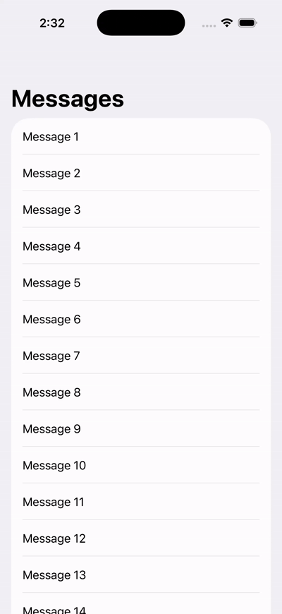
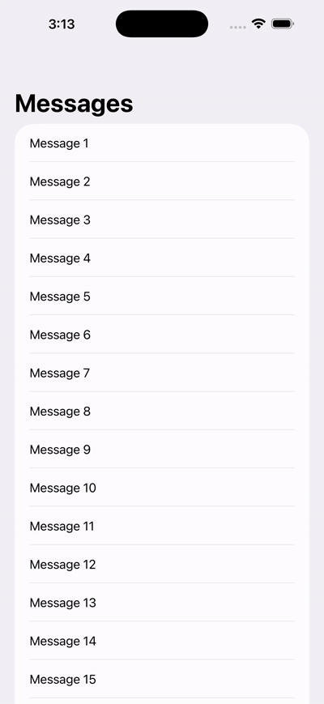
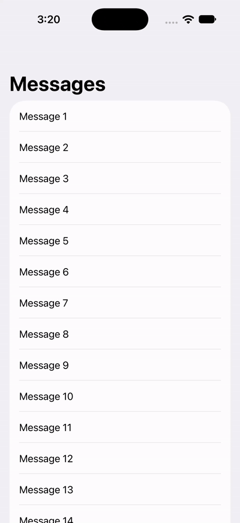

#  # Swipe to Pin 📌

A little SwiftUI experiment on making pin/unpin animations feel smoother in a `List`.

Adding `.swipeActions` was easy. Getting the rows to move smoothly? That took a bit more experimenting.

## Demo

### iOS 26 — Without vs With Row Revision

<table>
  <tr>
    <th>Without Revision</th>
    <th>With Revision</th>
  </tr>
  <tr>
    <td>
      
    </td>
    <td>
      
    </td>
  </tr>
</table>

### iOS 27 — Using onPresentationChanged




## What's happening?

When pinning or unpinning a row, updating the list while the swipe is still closing can make the animation look awkward.

Here's what worked in my testing:

**iOS 26**
- Wait 400 ms to let the swipe close before updating the list.
- Without a row revision, moving a message a long distance can cause an awkward sliding animation.
- With a display-only row revision, SwiftUI removes and reinserts the row at its new position instead.

**iOS 27**
- Uses Apple's `onPresentationChanged` callback to update the list when the swipe is dismissed.
- The normal row animation looked smooth in my testing, so I didn't need the extra row revision.

## What's a row revision?

SwiftUI uses an item's ID to track it in a list.

Normally, when an item changes position, SwiftUI recognizes it as the same row and animates it moving to the new position.

A **row revision** is a small trick to change how SwiftUI identifies the displayed row.

For example:

```swift
var id: String { "\(title)-\(revision)" }
```

When the revision changes from `0` to `1`, SwiftUI sees a different row identity.

Instead of animating the same row sliding through the list, it can animate the old row disappearing and the new one appearing in its new position.

The actual message stays the same. We're only changing its **display identity**, not its underlying data.

## Try it yourself

1. Open Xcode 27 or later.
2. Add `SwipePinDemoView.swift` to your iOS project.
3. Display the view:

```swift
WindowGroup {
    SwipePinDemoView()
}
```

Run it on iOS 26 and iOS 27 to compare the animations.

No ViewModel or backend needed!

## A few notes

- The 400 ms delay is a workaround based on testing, not an official SwiftUI animation duration.
- Row revisions change the displayed row's identity, not the actual message identity.
- Pin state is stored in memory, so it resets when the app restarts.

That's it! Feel free to use the code, experiment with it, or improve it. ✨
